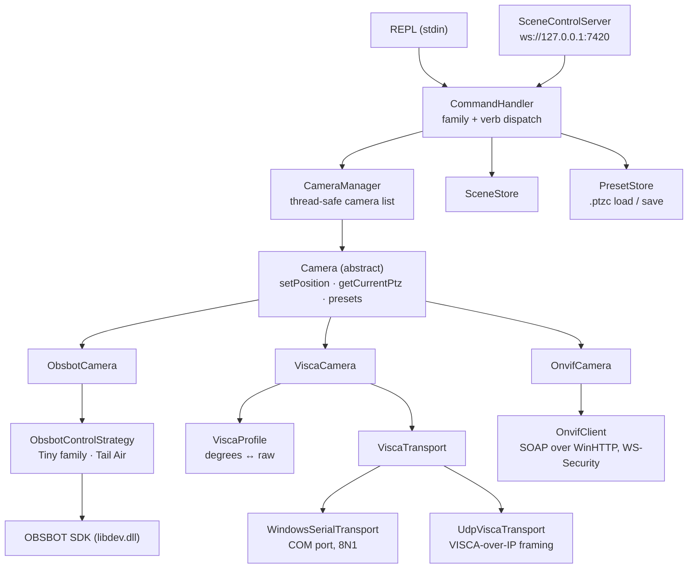
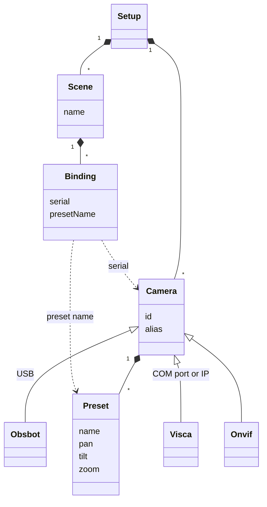

# Architecture

PTZ Commander gives cameras that speak different protocols one command set. An OBSBOT on USB, a VISCA camera on a COM port or the network, and an ONVIF camera all move with `camera move`, keep presets the same way, and take part in the same scenes. This document covers how that is organized and the parts that took the most work. The [README](../README.md) is the usage guide.

## Layers

**Commands.** Each command is a small class with a family (`camera`, `preset`, `scene`, `setup`) and a verb. `CommandHandler` registers them and dispatches `family verb args`, and `help` is generated from the registry. Adding a command means adding one class and one registration line.

**Cameras.** `Camera` is the only type the commands see. It exposes absolute pan, tilt, and zoom in degrees and percent, and it owns that camera's presets. Each protocol has its own subclass and an adapter that creates them: `ObsbotCameraAdapter` watches USB plug and unplug events on its own thread, and the VISCA and ONVIF adapters add cameras on request from `camera add` or `setup load`.

**Transports.** VISCA is the same byte protocol on a serial line and over UDP, so `ViscaCamera` talks to a `ViscaTransport` and does not know which one it has. The serial transport opens the COM port exclusively. The UDP transport wraps each message in the 8-byte VISCA-over-IP header (payload type, length, sequence number).

**Concurrency.** The REPL, the WebSocket server, and the OBSBOT hot-plug thread all reach the cameras. `CameraManager` guards its camera list with a mutex, and `Application` runs REPL commands and WebSocket scene applies under one command mutex, so a scene triggered from OBS never runs at the same time as a command typed into the REPL.

## Object model

A setup is what a `.ptzc` file holds. A preset is a name plus pan, tilt, and zoom on one camera. A scene stores references, not positions: each binding names a camera serial and a preset, and `scene apply` looks both up when it runs. Re-storing a preset therefore updates every scene that uses it, and a scene survives a camera being unplugged. The reasoning is in [ADR 0001](adr/0001-scenes.md).

## Parts worth a closer look

### Degrees to raw VISCA positions

VISCA cameras report and accept raw 16-bit positions, and every model maps them differently. A `ViscaAxis` describes one axis with its degree range, its raw stops, and its raw home position. Two properties cover the cameras that do not fit a straight line:

- `throughHome` maps each side of home separately, so 0° is the camera's home even when home is not the middle of the raw range (the Tenveo pans from `0x0000` through home at `0x4A6C` to `0x8E3E`).
- `signedRaw` reads positions as two's complement, so a range that crosses `0x0000` (the Lumens VC-A51P pans from `0x95C0` through `0x0000` to `0x6A40`) stays monotonic.

The mapping is pure code in `ViscaCommands.cpp` and is covered by unit tests that check the raw values from the Lumens command set.

### Calibration

A built-in profile can be wrong for a camera it was not written for. `camera calibrate` measures the camera instead: it drives each axis to its mechanical stops with velocity commands, waits until position inquiries stop changing, records the raw stops and home, does the same for zoom, and builds a profile from those readings and the spec-sheet angles. The measured profile is saved with the setup, and existing presets keep their physical positions.

### Discovery

`camera scan *` runs three searches at once and merges the results into one numbered table:

- **VISCA-IP:** sends a position inquiry to every address in the local /24 networks (or a named subnet). Any VISCA reply counts, including an error, because some cameras reject the version inquiry. A discovery broadcast is not used, since some cameras ignore it and broadcasts don't cross routers.
- **Serial:** opens every COM port in parallel and tries 9600 and 38400 baud at addresses 1 to 7.
- **ONVIF:** sends a WS-Discovery probe.

A scan only sends inquiries and moves nothing. `camera add` also sends an inquiry first, so a wrong address fails right away instead of leaving a camera that never moves.

### ONVIF

`OnvifClient` speaks SOAP over WinHTTP with no third-party SOAP library. Requests carry a WS-Security UsernameToken with a password digest (nonce, created time, SHA-1 through BCrypt). The created time comes from the camera's own clock, so a camera with the wrong time still authenticates. Moves use `AbsoluteMove` against the camera's PTZ profile.

### Stored credentials

ONVIF passwords are written to `.ptzc` files as Windows DPAPI blobs (`dpapi:` plus base64), which only the Windows user who saved them can decrypt. `setup export` writes the same file with those passwords omitted, so a setup can move to another PC or Windows account. `setup load` asks for a missing or undecryptable password. Skipping, or giving a password the camera rejects three times, leaves that camera in the setup, inactive, with its presets and scene bindings. `camera login` connects it later. A later `setup save` stores a password the user entered as a DPAPI blob for the current user, and writes an undecryptable blob back unchanged until a new password replaces it. Older plaintext files still load. A camera whose password decrypts but that does not answer stays inactive with that password. `camera login` retries it. The password never appears in logs or in the WebSocket snapshot. The socket accepts scene apply only, so `setup load` cannot block a client waiting for a password.

### OBS integration

`SceneControlServer` listens on `ws://127.0.0.1:7420` and sends the current setup as JSON when a client connects and whenever the setup changes. A client can send `{"op": "scene.apply", "name": "..."}`, and nothing else is accepted over the socket. `obs-panel/index.html` is a browser dock for OBS that lists the scenes and applies them.

## Build, test, and release

- **Build:** CMake with C++20 and MSVC x64. spdlog, nlohmann/json, IXWebSocket, and GoogleTest come in through `FetchContent`. Only the OBSBOT SDK is checked in, because it is not available any other way; [`lib/obsbot/README.md`](../lib/obsbot/README.md) explains its license status.
- **Tests:** GoogleTest covers the parts with no hardware: the degree mapping, VISCA-IP framing, ONVIF URL and XML parsing, argument splitting, DPAPI round trips and tamper detection, loading a setup whose ONVIF password is missing or cannot be decrypted, and `setup export` omitting those passwords.
- **CI:** every pull request builds the app and runs the tests on Windows.
- **Release:** pushing a `vX.Y.Z` tag builds a WiX MSI, stamps it with that version, and attaches it to a GitHub Release.

## Decisions

- [ADR 0001: Scenes as named preset bindings](adr/0001-scenes.md)
- [ADR 0002: Portable setup files](adr/0002-portable-setup.md)
- [VISCA PTZ ranges and coordinate system](VISCA-PTZ-Ranges-and-Coordinate-System.md)
